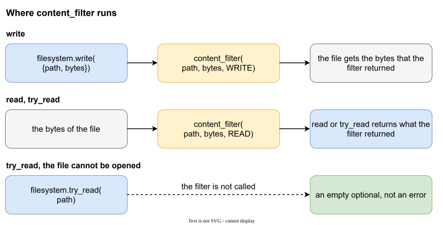

# File bytes and content_filter

`std::filesystem` knows about files, not about their contents. The code that reads a file uses `std::ifstream`, and a test cannot replace that. So `filesystem_t` has three members for the bytes of a file, and one function that can change the bytes on the way.

```cpp
using bytes_t = std::string;
using bytes_ot = std::optional<bytes_t>;

using try_read_ft = std::function<bytes_ot (const path_t&)>;
using read_ft = std::function<bytes_t (const path_t&)>;
using write_ft = std::function<void (const write_t&)>;

struct write_t
{
    path_t path;
    bytes_t bytes;
};
```

The bytes are a `std::string`. The files are opened in binary mode, so nothing is translated.

## try_read, read and write

| member | does |
| --- | --- |
| `try_read(path)` | returns the bytes, or an empty optional when the file cannot be opened. That is **not an error**: `on_error` does not run |
| `read(path)` | returns the bytes. When the file cannot be opened it is an error: `filesystem_error` goes to `on_error` |
| `write({.path, .bytes})` | replaces the bytes of the file. The file is created, or truncated if it exists |

Use `try_read` when a missing file is normal, for example an optional config. Use `read` when a missing file is a failure.

```cpp
// the text of dir/config.txt, or an empty string when there is none
filesystem.try_read(dir / "config.txt").value_or("");
```

An empty optional is different from an empty file: an empty file is `bytes_ot{""}`.

## content_filter

`content_filter` is a function that gets the bytes on their way in and out of the filesystem and returns the bytes to use instead:

```cpp
enum class content_filter_direction_et
{
    READ,
    WRITE
};

using content_filter_ft = std::function<bytes_t (
    const path_t&,
    const bytes_t&,
    content_filter_direction_et
)>;
```

The arguments are the path, the bytes, and the direction:

| direction | the bytes are | the result is |
| --- | --- | --- |
| `READ` | what the filesystem read from the file | what `read` or `try_read` returns |
| `WRITE` | what the caller gave to `write` | what the filesystem writes to the file |

Use it for what must happen to every file: decoding, decrypting, converting line endings, removing a byte order mark. The code that calls `read` and `write` does not change.

An empty `content_filter` leaves the bytes as they are.



## With make_filesystem

Pass the filter to `make_filesystem`. It is applied to `try_read`, `read` and `write` before the filesystem is returned.

This filter shifts every byte up by one on the way to the disk and down on the way back. The shift is a stand-in for real encryption:

```cpp
const auto filesystem = virtual_filesystem::make_filesystem({
    .content_filter = [](
        const virtual_filesystem::path_t&,
        const virtual_filesystem::bytes_t& bytes,
        const virtual_filesystem::content_filter_direction_et direction
    )
    {
        const auto shift = direction == virtual_filesystem::content_filter_direction_et::WRITE ? 1 : -1;
        auto result = bytes;
        std::ranges::transform(result, result.begin(), [shift](const char c)
        {
            return static_cast<char>(c + shift);
        });
        return result;
    }
});

filesystem.write({.path = file, .bytes = "HAL"});
filesystem.read(file);      // "HAL"
filesystem.try_read(file);  // "HAL"
```

A filesystem without the filter sees what is on the disk:

```cpp
const auto plain = virtual_filesystem::make_filesystem({});
plain.read(file);           // "IBM"
```

## With a filesystem you built

A `filesystem_t` that you filled by hand, for a test, has its `content_filter` set but not applied. Call `apply_content_filter` once. It wraps the three members of the filesystem:

```cpp
void apply_content_filter(filesystem_t&);
```

```cpp
virtual_filesystem::bytes_t on_disk = "one\r\ntwo\r\n";

virtual_filesystem::filesystem_t filesystem;
filesystem.read = [&](const virtual_filesystem::path_t&)
{
    return on_disk;
};
filesystem.write = [&](const virtual_filesystem::write_t& args)
{
    on_disk = args.bytes;
};
filesystem.content_filter = [](
    const virtual_filesystem::path_t&,
    const virtual_filesystem::bytes_t& bytes,
    const virtual_filesystem::content_filter_direction_et direction
)
{
    if (direction == virtual_filesystem::content_filter_direction_et::WRITE)
    {
        return bytes;
    }
    auto text = bytes;
    std::erase(text, '\r');
    return text;
};

virtual_filesystem::apply_content_filter(filesystem);

filesystem.read("notes.txt");  // "one\ntwo\n": the carriage returns are gone
```

The test checks the filter without any file: the fake `read` returns what the "disk" holds, and the filter turns it into what the code sees.

!!! warning
    `apply_content_filter` wraps what the members are at the moment of the call. Call it once. A second call wraps the wrapped members, and the filter runs twice. `make_filesystem` already calls it, so do not call it again on its result.

## Details

- `try_read` calls the filter **only when it has bytes**. A missing file stays an empty optional and the filter is not called.
- The filter wraps the members from the outside. An exception from the filter leaves the call; `on_error` does not see it.
- If `read` fails and `on_error` returns, `read` returns empty bytes and the filter is called with them.
- The filter sees every file the same way. Look at the path when files differ.
- The logger sees `TRY_READ`, `READ` and `WRITE`. The filter is not a call of its own and is not logged.
