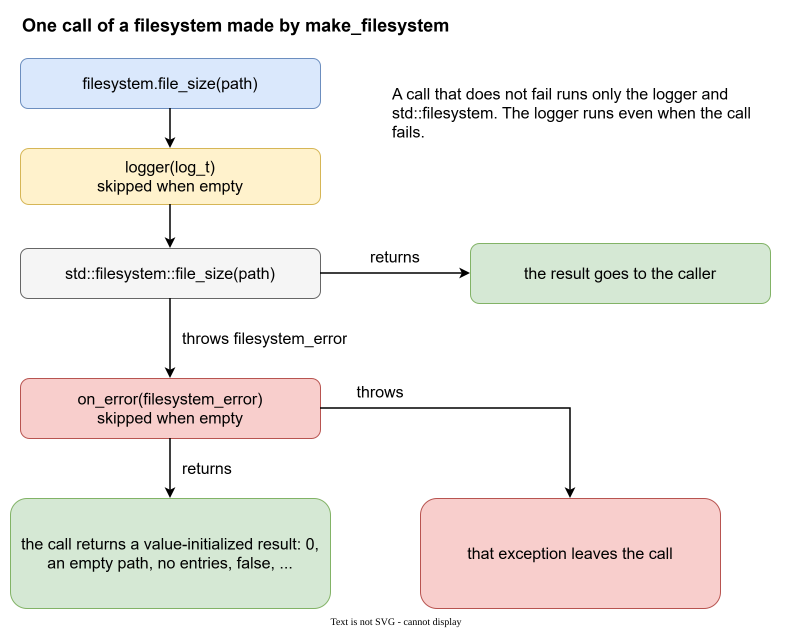

# Errors and logging

`make_filesystem` fills a `filesystem_t` from `std::filesystem` and puts two functions around every call: a **logger** that runs before the call, and an **error handler** that receives a `std::filesystem::filesystem_error`.

```cpp
struct make_filesystem_t
{
    logger_ft logger;                  // void (const log_t&)
    error_ft on_error;                 // void (const std::filesystem::filesystem_error&)
    content_filter_ft content_filter;  // see "File bytes and content_filter"
};

filesystem_t make_filesystem(const make_filesystem_t&);
```

Every field is optional. An empty function is skipped.

## The order of events

For every call the order is the same:

1. The logger runs with a `log_t`: which operation, which paths.
2. The call goes to `std::filesystem`.
3. If `std::filesystem` throws `filesystem_error`, `on_error` runs with it.



```cpp
std::vector<std::string> events;
const auto filesystem = virtual_filesystem::make_filesystem({
    .logger = [&](const virtual_filesystem::log_t& log)
    {
        events.push_back("log " + log.path.generic_string());
    },
    .on_error = [&](const std::filesystem::filesystem_error& error)
    {
        events.push_back("error " + error.path1().generic_string());
    }
});

filesystem.file_size("missing.txt");
filesystem.rename({.from = "missing_a.txt", .to = "missing_b.txt"});
```

`events` is now:

```text
log missing.txt
error missing.txt
log missing_a.txt
error missing_a.txt
```

A call is logged even when it fails, and a call that does not fail is logged and nothing more.

## What the call returns when on_error returns

`filesystem_error` does not leave the call. When `on_error` returns, the call returns a **value-initialized result**, the same as `Result{}`:

| the call returns | after an error |
| --- | --- |
| `bool` (`create_directory`, `remove`, `equivalent`, ...) | `false` |
| `std::uintmax_t` (`file_size`, `remove_all`, ...) | `0` |
| `path_t` (`canonical`, `read_symlink`, ...) | an empty path |
| `fs::file_status` (`status`, `symlink_status`) | type `none` |
| `fs::file_time_type` | the epoch of the clock |
| `fs::space_info` | all three sizes `0` |
| `entries_t` (`list`) | no entries |
| `bytes_t` (`read`) | no bytes |
| `bytes_ot` (`try_read`) | an empty optional |
| `void` (`rename`, `write`, ...) | nothing |

```cpp
const auto filesystem = virtual_filesystem::make_filesystem({});

filesystem.file_size("missing.txt");         // 0
filesystem.read_symlink("missing.txt");      // an empty path
filesystem.list({.root = "missing_dir"});    // no entries
filesystem.read("missing.txt");              // no bytes
filesystem.remove("missing.txt");            // false
```

Here the filesystem has no `on_error` at all: the call neither logs nor throws, and the result is empty. That is the way to say "I do not care about errors".

!!! warning
    A result that is empty after an error looks like a result that is empty because there is nothing to find. If the difference matters, record the error in `on_error`, or make `on_error` throw.

`exists`, `is_directory` and the other [queries](queries.md) treat a status of type `none` like `not_found`: a file that could not be examined is not there.

## What is not an error

Some calls fail without `filesystem_error`, because `std::filesystem` and the library say so:

- `status` and `symlink_status` of a missing file return `file_type::not_found`. `on_error` does not run.
- `try_read` of a file that cannot be opened returns an empty optional. `on_error` does not run. That is why the function exists next to `read`.
- `read` of a file that cannot be opened is an error: it throws `filesystem_error` with `no_such_file_or_directory` for a missing file and `io_error` for another reason, so `on_error` runs.
- `write` that cannot open or finish the file is an error with `io_error`.

## An exception from on_error

`on_error` may throw an exception of its own. The library does not catch it: it leaves the call. Use it to turn a `filesystem_error` into your own type, or to stop at the first failure:

```cpp
const auto strict = virtual_filesystem::make_filesystem({
    .on_error = [](const std::filesystem::filesystem_error& error)
    {
        throw std::runtime_error{"cannot use " + error.path1().filename().string()};
    }
});

strict.file_size("missing.txt");  // throws std::runtime_error "cannot use missing.txt"
```

The same holds for the logger: an exception from it leaves the call, and the call to `std::filesystem` is not made.

## The log

```cpp
struct log_t
{
    operation_et operation;
    path_t path;
    path_t other;
};
```

`operation` is one of the values of `operation_et`: `STATUS`, `FILE_SIZE`, `RENAME`, `LIST`, `READ`, `WRITE` and so on. There is one value for every member of `filesystem_t` except `content_filter`.

`path` is the file the call names. It is empty for calls that name no path: `CURRENT_PATH` and `TEMP_DIRECTORY`.

`other` is the second path of a call that names two: the target of `RENAME`, `COPY`, `CREATE_SYMLINK`, `CREATE_DIRECTORY_SYMLINK` and `CREATE_HARD_LINK`, and the second path of `EQUIVALENT`. It is empty for all the others.

```cpp
const auto filesystem = virtual_filesystem::make_filesystem({
    .logger = [](const virtual_filesystem::log_t& log)
    {
        std::cout << log.path.generic_string() << " -> " << log.other.generic_string() << "\n";
    }
});

filesystem.rename({.from = "missing_a.txt", .to = "missing_b.txt"});
```

It prints:

```text
missing_a.txt -> missing_b.txt
```

The logger sees the calls of `filesystem_t`, not the calls of the [queries](queries.md). `exists(filesystem, path)` shows up as one `STATUS`.

!!! note
    `ABSOLUTE_PATH` is not named `ABSOLUTE`, because `wingdi.h` defines a macro with that name.

## Faking and errors

`on_error` and the logger belong to the filesystem that `make_filesystem` made. A fake that you write yourself has no logger and no handler: whatever it throws leaves the call. See [Replacing calls in a test](faking.md).
