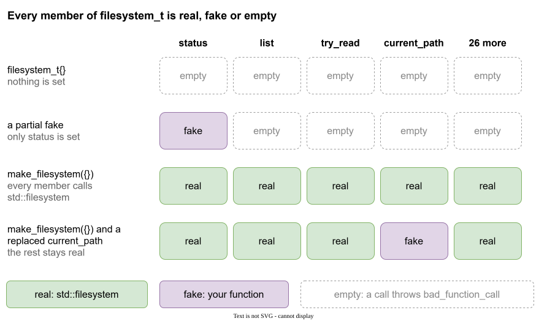
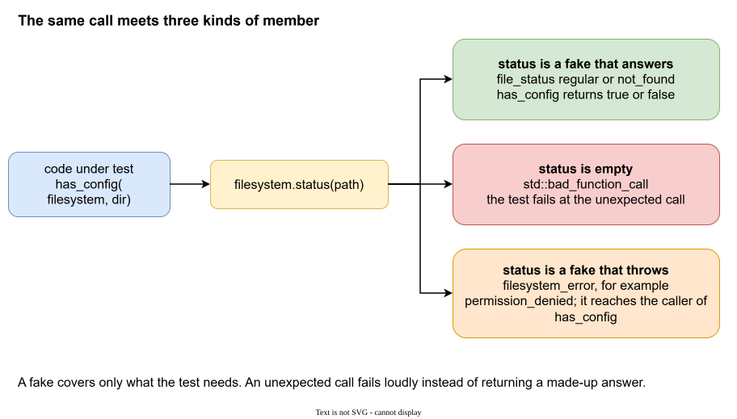
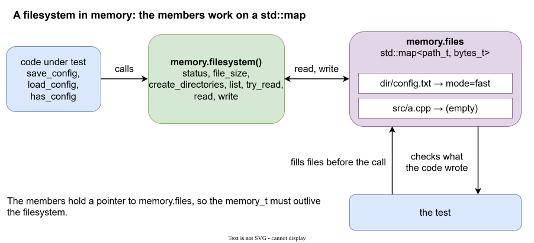

# Replacing calls in a test

`filesystem_t` is a struct of `std::function` members. A test builds one and sets what the code under test needs. The code under test takes `const filesystem_t&`, so it works the same with the disk, a fake or a log.



The code on this page is in the `example/` directory of the library: `config_loader.hpp`, `memory_filesystem.hpp` and `main.cpp`.

## The code under test

```cpp
// true when dir has a regular file config.txt
inline bool has_config(
    const virtual_filesystem::filesystem_t& filesystem,
    const virtual_filesystem::path_t& dir
)
{
    return virtual_filesystem::is_regular_file(filesystem, dir / "config.txt");
}

// the text of dir/config.txt, or an empty string when there is none
inline std::string load_config(
    const virtual_filesystem::filesystem_t& filesystem,
    const virtual_filesystem::path_t& dir
)
{
    return filesystem.try_read(dir / "config.txt").value_or("");
}
```

Nothing here says where the files are. In the program you pass `make_filesystem({})`. In a test you pass a fake.

`has_config` ends in a call of `status`. What happens to that call depends on what the test put in `status`:



The next sections show each case.

## A partial fake

A default-constructed `filesystem_t` has every member empty. Set only the members that the code under test calls. `has_config` calls `is_regular_file`, which calls `status`, so one member is enough:

```cpp
namespace fs = std::filesystem;

virtual_filesystem::filesystem_t filesystem;
filesystem.status = [](const virtual_filesystem::path_t& path)
{
    return path == "dir/config.txt"
        ? fs::file_status{fs::file_type::regular}
        : fs::file_status{fs::file_type::not_found};
};

example::has_config(filesystem, "dir");    // true
example::has_config(filesystem, "other");  // false
```

The fake answers by path, so one fake covers many cases.

!!! warning
    Calling an empty member throws `std::bad_function_call`. This is useful in a test: a call that you did not expect fails loudly instead of returning a made-up answer.

```cpp
virtual_filesystem::filesystem_t empty;
empty.file_size("a");  // throws std::bad_function_call
```

## A fake that fails

A fake can throw `std::filesystem::filesystem_error`, the exception that `std::filesystem` throws. The failure reaches the code under test the way a real one would:

```cpp
virtual_filesystem::filesystem_t denied;
denied.status = [](const virtual_filesystem::path_t& path) -> fs::file_status
{
    throw fs::filesystem_error{
        "status",
        path,
        std::make_error_code(std::errc::permission_denied)
    };
};

example::has_config(denied, "dir");  // throws filesystem_error, path1() is "dir/config.txt"
```

Without the library a test cannot make "permission denied" without a real file that is locked for the user.

A filesystem that `make_filesystem` made catches errors of the real calls; it does not catch the exceptions of a fake that you set afterwards. See [Errors and logging](errors.md).

## Replace one member of a real filesystem

`make_filesystem` returns an ordinary value. Replace a member of it when the rest should stay real:

```cpp
auto filesystem = virtual_filesystem::make_filesystem({});
filesystem.current_path = []
{
    return virtual_filesystem::path_t{"/work"};
};

filesystem.current_path();  // "/work", other members still use the disk
```

## A filesystem in memory

When a test reads and writes files, one fake per call becomes long. `memory_t` of the example is a fake that keeps files in a `std::map` and fills seven members: `status`, `file_size`, `create_directories`, `list`, `try_read`, `read` and `write`.

```cpp
struct memory_t
{
    std::map<virtual_filesystem::path_t, virtual_filesystem::bytes_t> files;

    virtual_filesystem::filesystem_t filesystem();
};
```



The members of `filesystem()` read and write `files`, so the `memory_t` must outlive the filesystem. Here is a piece of it, `try_read` and `write`:

```cpp
result.try_read = [this](const vfs::path_t& path) -> vfs::bytes_ot
{
    const auto found = files.find(path);
    if (found == files.end())
    {
        return {};
    }
    return found->second;
};

result.write = [this](const vfs::write_t& args)
{
    files[args.path] = args.bytes;
};
```

A test uses it with the code under test:

```cpp
example::memory_t memory;
const auto filesystem = memory.filesystem();

example::load_config(filesystem, "dir");                  // "": there is no file
example::save_config(filesystem, "dir", "mode=fast");     // writes dir/config.txt
example::load_config(filesystem, "dir");                  // "mode=fast"
example::has_config(filesystem, "dir");                   // true
filesystem.file_size("dir/config.txt");                   // 9
```

You can look into `memory.files` to see what the code wrote, and fill it before the call to prepare input.

!!! note
    `memory_t` is an example, not a part of the library. Directories are not stored. A memory filesystem for your tests should answer the calls your code makes and no more.

## What a fake should answer

A fake replaces a call of `std::filesystem`, so it should answer the way `std::filesystem` does:

- `status` of a missing file is `file_type::not_found`. It is not an error.
- `file_size` of a missing file throws `filesystem_error`.
- `try_read` of a missing file is an empty optional. `read` of a missing file throws `filesystem_error`.

The [reference](reference.md) lists the result type of every member.
