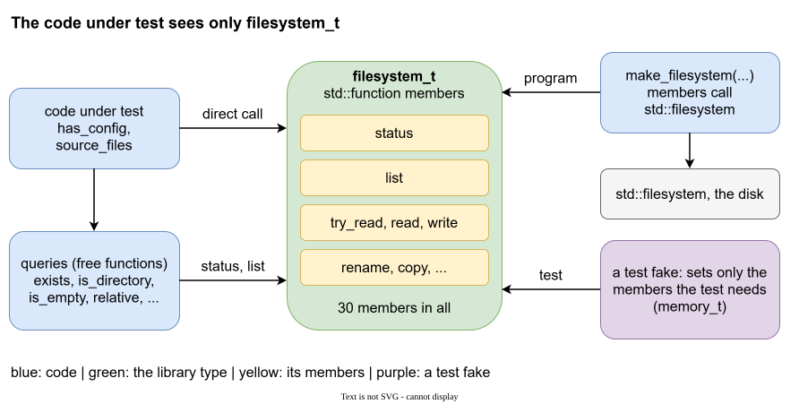

# A filesystem you can replace in a test

## The problem

[`std::filesystem`](https://en.cppreference.com/w/cpp/filesystem) is a set of free functions. Code that calls them talks to the real disk, and there is no place to put anything between the code and the disk.

```cpp
bool has_config(const std::filesystem::path& dir)
{
    return std::filesystem::is_regular_file(dir / "config.txt");
}
```

A test of this function needs a real directory with a real file. That has a price:

- **Tests touch the disk.** They need a temporary directory, clean-up, and care about parallel runs.
- **Failures are hard to make.** To test "permission denied" or "disk is full" you must arrange them on a real machine.
- **Errors are everywhere.** Most functions throw `std::filesystem::filesystem_error`, and every function has a second overload with `std::error_code`. Each call site picks one of two styles and repeats it.
- **No view of the calls.** You cannot ask "which paths did this code touch?" without a debugger.
- **The bytes of a file are not covered.** `std::filesystem` knows about files, but not about reading or writing them. The code that reads a file uses `std::ifstream`, which is another thing a test cannot replace.

## What the library does

`virtual_filesystem::filesystem_t` is a struct. Every member is a `std::function`, and every member is one operation that a filesystem must answer: `status`, `file_size`, `rename`, `list`, `read`, `write` and so on.

Production code takes a `const filesystem_t&` and calls its members:

```cpp
bool has_config(
    const virtual_filesystem::filesystem_t& filesystem,
    const virtual_filesystem::path_t& dir
)
{
    return virtual_filesystem::is_regular_file(filesystem, dir / "config.txt");
}
```

In the program the filesystem is made from `std::filesystem`:

```cpp
const auto filesystem = virtual_filesystem::make_filesystem({});
```

In a test any member is replaced by a function that answers what the test needs:

```cpp
virtual_filesystem::filesystem_t filesystem;
filesystem.status = [](const virtual_filesystem::path_t&)
{
    return std::filesystem::file_status{std::filesystem::file_type::regular};
};
```



What you get:

- **A seam.** The code under test sees `filesystem_t` and does not know what is behind it.
- **A fake per member.** A test sets only the members the code under test calls.
- **One error policy.** `make_filesystem` catches `filesystem_error` and hands it to one function, `on_error`. The call does not throw unless that function does.
- **A log of calls.** A `logger` function sees every call, with its paths, before it runs.
- **Rules that cannot disagree with a fake.** `exists`, `is_directory`, `is_empty`, `relative` and the other queries are free functions built on the members. A fake `status` changes what they answer.
- **File bytes.** `try_read`, `read` and `write` are members too, and a `content_filter` can change the bytes on the way in and out.

It is a thin layer. It adds no files and no state of its own: `make_filesystem` forwards each call to `std::filesystem`.

## How this documentation is arranged

1. [Getting started](getting-started.md): requirements, CMake and a first program.
2. The guide:
    - [Replacing calls in a test](faking.md): fakes, partial fakes and failing fakes.
    - [Errors and logging](errors.md): `logger`, `on_error` and the value you get back.
    - [Queries](queries.md): the rules built on the members.
    - [Listing a directory](list.md): `list` and its options.
    - [File bytes and content_filter](bytes.md): `try_read`, `read`, `write` and the filter.
3. [Reference](reference.md): every function, type and enumeration.
